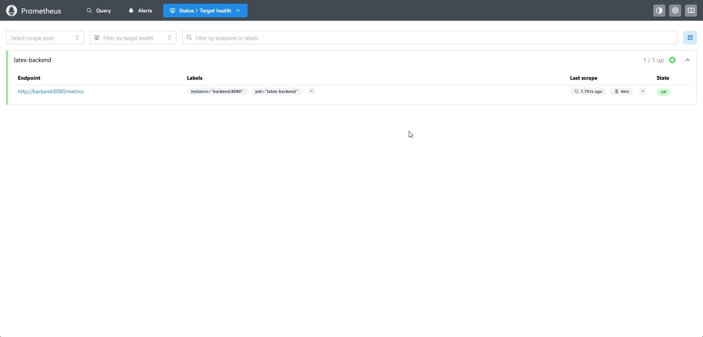
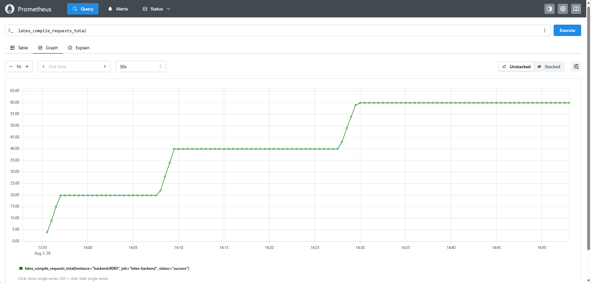
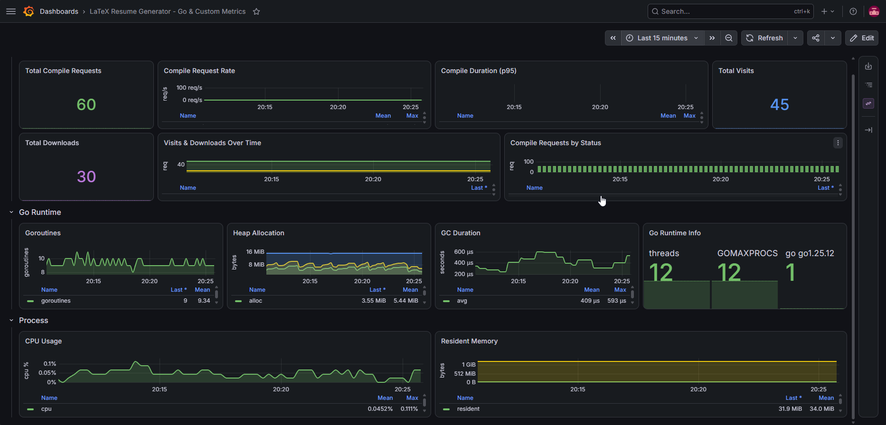
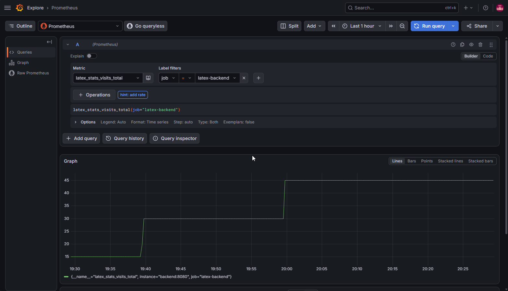
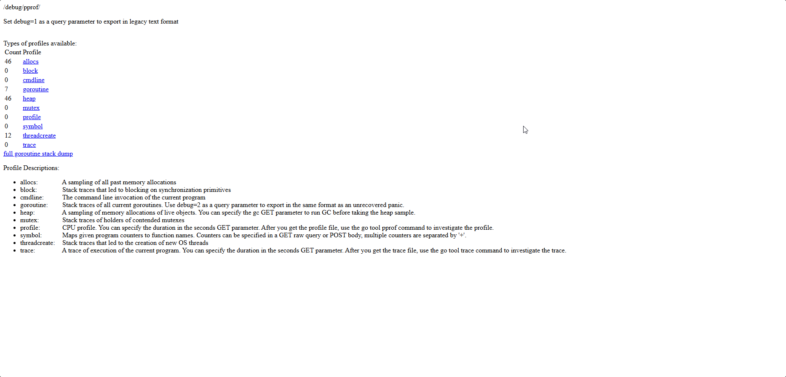
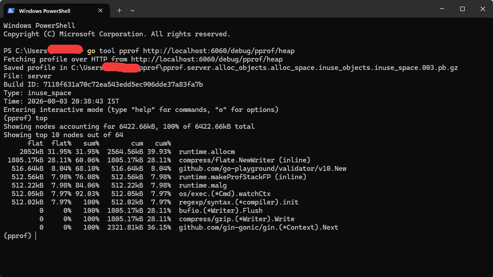

# CVStack - LaTeX Resume Generator

A frontend-first resume builder for ATS-oriented, LaTeX-typeset resumes. Build a resume in the browser, preview it instantly, save encrypted versions locally, and export either the LaTeX source or a compiled PDF.

**[Live Demo](https://latex-resume-gen.vercel.app/)** | **[GitHub](https://github.com/LoganX64/Latex-resume-gen)**

---

## Features

- **Frontend-first architecture** - No accounts and no resume database. Resume data and saved versions live in the browser.
- **Live split-screen editor** - Edit structured content on the left and see the selected template on the right.
- **Template-aware preview** - HTML/CSS rendering with A4 page simulation, pagination, zoom, pan, and fullscreen mode.
- **Drag-and-drop ordering** - Reorder sections and entries with `@dnd-kit`.
- **Show/hide and collapse** - Toggle sections in the editor and collapse them to reduce visual noise.
- **9 LaTeX templates** - Includes single-column ATS-oriented layouts and visual two-column/sidebar layouts.
- **Profile photo support** - Upload and crop a photo for the Engineering and Modern Sidebar templates.
- **Categorized skills** - Organize skills into reorderable categories.
- **Multiple entries** - Add multiple experience, education, project, certification, achievement, publication, language, and custom-section entries.
- **LaTeX export** - Generate a standalone `.tex` file locally for Overleaf, TeX Live, or MiKTeX.
- **PDF export** - Compile through the Go backend with Tectonic over a WebSocket, with live progress.
- **Multi-page warning** - Warns when a PDF exceeds one page and lets the user download it anyway.
- **Version history** - Save, load, update, and delete resume versions in encrypted local storage.
- **Encrypted local storage** - AES-GCM 256-bit encryption with PBKDF2 key derivation for persisted resume data.
- **Command palette and shortcuts** - `Ctrl/Cmd+K` for actions; shortcuts for PDF, LaTeX, save, theme, and home.
- **Dark/light mode and auto-save** - Theme and editor state persist automatically.
- **Responsive/mobile UI** - Dedicated mobile navbar, sidebar, preview sheet, and saved-resume sheet.
- **Chunk-load recovery** - Retries failed dynamic imports and rate-limits automatic reloads after deploy races.
- **Error tracking and analytics** - Production-only Sentry with error-only replays, plus Vercel Analytics.
- **Admin stats dashboard** - `/admin/stats`, protected by `ADMIN_KEY`, shows aggregate visits and downloads.
- **Observability** - Prometheus metrics, a provisioned Grafana dashboard, and optional pprof.
- **SEO and prerendering** - Open Graph/Twitter metadata, JSON-LD, robots.txt, sitemap.xml, and prerendered `/` and `/404`.
- **Security hardening** - Constant-time key checks, CORS/WebSocket origin checks, rate limiting, request-size limits, security headers, `--untrusted` Tectonic compilation, and non-root containers.

> **Privacy note:** Resume data is stored locally and LaTeX export happens in the browser. PDF export sends the generated LaTeX and optional profile image to the compile backend, where temporary files are deleted after compilation. The backend stores only aggregate visit/download counters in SQLite, not resume content.

---

## Tech Stack

### Frontend

| Technology | Version | Purpose |
|------------|---------|---------|
| React | 19 | UI framework |
| TypeScript | 6.0 | Type safety |
| Vite | 8.3 | Build tool and dev server |
| Tailwind CSS | 4.3 | Utility-first styling |
| shadcn/ui | 4.16 (Base UI) | Component library |
| Zustand | 5 | State management and persistence |
| React Router | 7 | Client-side routing |
| Framer Motion | 13 | UI motion and transitions |
| @dnd-kit | core 6, sortable 10 | Drag-and-drop |
| Font Awesome | 7 | Icons |
| react-easy-crop | 6 | Profile-image cropping |
| Sentry React | 10 | Error tracking and feedback |
| Vercel Analytics | 2 | Privacy-friendly page analytics |
| pnpm | 10.33.2 | Package manager |
| Puppeteer | 24 | Build-time prerendering |

### Backend

| Technology | Purpose |
|------------|---------|
| Go 1.25.1 | Runtime |
| Gin 1.12 | HTTP router |
| Gorilla WebSocket | Real-time compilation streaming |
| modernc.org/sqlite | Pure-Go SQLite stats database |
| golang.org/x/time/rate | Per-IP token-bucket rate limiting |
| prometheus/client_golang | Prometheus metrics |
| joho/godotenv | Environment variable loading |
| Tectonic 0.16.9 | LaTeX-to-PDF compiler |
| gin-contrib/cors | CORS middleware |

### DevOps

| Technology | Purpose |
|------------|---------|
| Docker | Containerization |
| Docker Compose | Local/self-hosted multi-service orchestration |
| Prometheus | Metrics collection |
| Grafana | Provisioned monitoring dashboard |
| Sentry | Frontend error tracking and source maps |
| Vercel | Frontend hosting and API rewrite |
| Render | Backend Docker deployment (`render.yaml`) |

---

## Architecture

```text
Browser (Vercel or Docker/Nginx)
  React 19 SPA
    - encrypted localStorage: current resume + saved versions
    - template-aware HTML/CSS preview
    - local LaTeX generation and .tex download
    - Sentry (production only) + Vercel Analytics
    |
    | WebSocket /api/compile/ws (API key in query string)
    | or HTTP POST /api/compile (X-API-Key)
    v
Go/Gin backend (Render or Docker)
  - API-key middleware + CORS/WebSocket origin allowlist
  - per-IP rate limiting
  - Tectonic compilation (120s default timeout, --untrusted)
  - temporary .tex/profile-image/PDF files, cleaned after compile
  - SQLite aggregate stats
  - /metrics with Basic Auth -> Prometheus -> Grafana
  - optional pprof
```

### Request flow

1. The user edits the resume; Zustand persists the current state to encrypted `localStorage`.
2. LaTeX export generates the `.tex` string in the browser and downloads it directly.
3. PDF export generates the LaTeX, opens `/api/compile/ws`, and sends `{ latex, profileImage }`.
4. The backend writes temporary files, runs Tectonic, and streams progress messages.
5. The backend sends `{ type: "complete", pageCount }` followed by the PDF binary frame.
6. The frontend downloads the PDF and records an aggregate download event.
7. If the page count is greater than one, the UI shows the multi-page warning first.

### Routes and ports

| Route / service | Location |
|-----------------|----------|
| `/` | Homepage |
| `/editor` | Resume editor |
| `/admin/stats` | Admin stats dashboard (`X-Admin-Key`) |
| `/v2` | Redirect to `/` |
| `/editor-v2` | Redirect to `/editor` |
| `*` | 404 page |
| Frontend dev server | `http://localhost:5173` |
| Frontend Docker | `http://localhost:3000` (container port 8080) |
| Backend | `http://localhost:8080`; Render uses `SERVER_PORT=10000` |
| Prometheus | `http://localhost:9090` |
| Grafana | `http://localhost:3001` (container port 3000) |
| pprof | `http://localhost:6060` when `PPROF_ENABLED=true` |

---

## Project Structure

```text
latex-resume-gen/
├── frontend/
│   ├── src/
│   │   ├── components/
│   │   │   ├── common/          # Shared components
│   │   │   ├── editor/          # Resume forms and section wrappers
│   │   │   ├── mobile/          # Mobile navbar, sidebar, preview/saved sheets
│   │   │   ├── motion/          # Motion helpers and transitions
│   │   │   ├── preview/         # Shared preview components
│   │   │   ├── ui/              # shadcn/Base UI primitives
│   │   │   └── v2/
│   │   │       ├── editor/      # Editor shell and sidebar
│   │   │       ├── home/        # Landing page sections and visuals
│   │   │       ├── preview/     # ResumePreviewV2
│   │   │       └── shared/      # Shared v2 components
│   │   ├── hooks/               # Export, WebSocket, shortcuts, mobile, motion
│   │   ├── layouts/             # EditorV2Layout
│   │   ├── lib/                 # crypto, icons, motion, preload error handling
│   │   ├── pages/               # HomePageV2, StatsDashboard, NotFoundPage
│   │   ├── stores/              # resume-store, versions-store
│   │   ├── templates/           # 9 template folders + shared LaTeX helpers
│   │   ├── types/               # Resume, section, template, and version types
│   │   ├── utils/               # download, quick-export, stats
│   │   ├── sentry.ts            # Production-only Sentry initialization
│   │   ├── App.tsx
│   │   ├── main.tsx
│   │   └── index.css
│   ├── public/                  # favicon, logo, og-image, robots.txt, sitemap.xml
│   ├── scripts/prerender.mjs    # Puppeteer prerender for / and /404
│   ├── Dockerfile               # Builds with pnpm build:fast
│   ├── nginx.conf               # SPA fallback, API/WS proxy, security headers
│   ├── vercel.json              # SPA routes, API rewrite, security headers
│   ├── vite.config.ts           # React, Tailwind, Sentry, dev proxy
│   ├── package.json
│   └── tsconfig.json
├── backend/
│   ├── cmd/server/main.go       # Entry point, routes, config
│   ├── internal/
│   │   ├── compiler/            # Tectonic compilation + progress events
│   │   ├── handlers/            # Compile and stats handlers
│   │   ├── metrics/             # Prometheus metrics
│   │   ├── middleware/          # API key, admin key, basic auth, rate limit
│   │   ├── stats/               # SQLite stats database
│   │   └── websocket/           # WebSocket compile streaming
│   ├── Dockerfile
│   ├── go.mod
│   └── go.sum
├── prometheus/prometheus.yml
├── grafana/
│   ├── dashboards/latex-resume-go.json
│   └── provisioning/
├── screenshots/
├── docker-compose.yml
├── render.yaml
└── README.md
```

---

## Getting Started

### Prerequisites

- **Node.js** 20.19+ or 22.12+ (tested with 22.21.1)
- **pnpm** 10.33.2 (`corepack enable` is enough)
- **Docker Desktop** for the recommended Compose setup
- **Go** 1.25.1+ for local backend development
- **Tectonic** 0.16.9+ only when running the backend without Docker
- **Chrome/Chromium** for `pnpm build` prerendering; Docker uses `build:fast` and skips it

### Docker Compose (recommended)

Create a root `.env` for Compose interpolation and a `backend/.env` for the backend. Use the environment-variable reference below; `COMPILE_API_KEY` must match in both files, and `ALLOWED_ORIGINS` must include the frontend origin.

Then run:

```bash
docker compose up --build
```

- Frontend: `http://localhost:3000`
- Backend: `http://localhost:8080`
- Prometheus: `http://localhost:9090`
- Grafana: `http://localhost:3001` (`admin` / `GRAFANA_ADMIN_PASSWORD`, default `admin`)
- Tectonic cache and SQLite stats persist in the `tectonic-cache` and `stats-data` volumes.

The frontend image is built with `pnpm build:fast`; it does not run the Puppeteer prerender step.

### Local development

#### Frontend

```bash
cd frontend
pnpm install
pnpm dev
```

Create `frontend/.env` from `frontend/.env.example` and fill in the values described in the environment-variable reference below. `VITE_COMPILE_API_KEY` must match the backend key.

The dev server runs at `http://localhost:5173` and proxies `/api` (including WebSocket) to `http://localhost:8080`.

#### Backend

Create `backend/.env` using the environment-variable reference below. `ALLOWED_ORIGINS` must include the browser origin.

Then:

```bash
cd backend
go mod download
go run ./cmd/server
```

PDF export requires Tectonic installed and available in `PATH`:

```bash
tectonic --version
```

> `ALLOWED_ORIGINS` must include the browser origin. The WebSocket upgrade checks the same allowlist, so an empty value blocks local browser compilation.

### Build and checks

```bash
cd frontend

# Typecheck + production build + prerender (/ and /404)
pnpm build

# Typecheck + production build only (used by Docker)
pnpm build:fast

# Typecheck only
pnpm exec tsc --noEmit
```

There is currently no test or lint script. `pnpm build` requires Chrome/Chromium for prerendering; set `PUPPETEER_SKIP_DOWNLOAD=true` only when you intentionally do not need prerendering.

Sentry source-map upload is build-time only. Without `SENTRY_AUTH_TOKEN`, Vite prints a warning and skips release creation/upload; the build still succeeds.

---

## Environment Variables

### Frontend (`frontend/.env`)

| Variable | Default | Purpose |
|----------|---------|---------|
| `VITE_GITHUB_URL` | empty; footer falls back to the repo URL | GitHub link in the navbar/footer |
| `VITE_API_BASE_URL` | `/api` | Base URL for stats requests |
| `VITE_API_PROXY_TARGET` | `http://localhost:8080` | Vite dev proxy target for `/api` and WebSocket |
| `VITE_DEV_SERVER_PORT` | `5173` | Vite dev-server port |
| `VITE_WS_URL` | same-origin | Optional direct WebSocket origin, e.g. `wss://backend.example.com` |
| `VITE_COMPILE_API_KEY` | empty | Must match backend `COMPILE_API_KEY`; embedded in the client bundle |
| `VITE_ENCRYPTION_KEY` | public fallback string | Client-side passphrase for localStorage encryption; not a server secret |
| `VITE_SENTRY_DSN` | empty | Sentry DSN; Sentry only initializes in production |
| `SENTRY_ORG` | empty | Sentry organization for build-time source-map upload |
| `SENTRY_PROJECT` | empty | Sentry project for build-time source-map upload |
| `SENTRY_AUTH_TOKEN` | empty | Build-time upload token for CI/Vercel; never prefix with `VITE_` |

`VITE_*` values are compiled into the frontend bundle and are public. Do not put server secrets in them.

### Backend (`backend/.env`)

| Variable | Default | Purpose |
|----------|---------|---------|
| `SERVER_PORT` | `8080` | HTTP server port |
| `MAX_REQUEST_SIZE_BYTES` | `5242880` | Maximum request body size (5 MB) |
| `ALLOWED_ORIGINS` | empty | Comma-separated CORS and WebSocket origin allowlist |
| `CORS_MAX_AGE` | `12h` | CORS preflight cache duration |
| `RATE_LIMIT_RPS` | `5` | Requests per second per IP |
| `RATE_LIMIT_BURST` | `10` | Maximum burst size |
| `RATE_LIMITER_CLEANUP_SECONDS` | `60` | Rate-limiter cleanup interval |
| `RATE_LIMITER_VISITOR_TTL_SECONDS` | `180` | Idle visitor expiry |
| `RATE_LIMITER_MSG` | `Rate limit exceeded. Try again later.` | 429 response message |
| `COMPILE_TIMEOUT_SECONDS` | `120` | Tectonic compilation timeout |
| `COMPILE_API_KEY` | empty (required) | Key for `/api/compile` and `/api/compile/ws` |
| `STATS_DB_PATH` | `/data/stats.db` | SQLite stats database path |
| `ADMIN_KEY` | empty (required for dashboard) | Key for `/api/stats/dashboard` and `/admin/stats` |
| `METRICS_USER` | empty | Basic-auth username for `/metrics` |
| `METRICS_PASS` | empty | Basic-auth password for `/metrics` |
| `PPROF_ENABLED` | `false` | Enables the optional pprof server |
| `PPROF_PORT` | `6060` | pprof HTTP port |

### Docker Compose (root `.env`)

| Variable | Default | Purpose |
|----------|---------|---------|
| `COMPILE_API_KEY` | empty | Passed as `VITE_COMPILE_API_KEY` at frontend build time; must match `backend/.env` |
| `GRAFANA_ADMIN_PASSWORD` | `admin` | Grafana admin password |

`prometheus/prometheus.yml` currently scrapes `/metrics` with `prom` / `prom`. If you change `METRICS_USER` or `METRICS_PASS`, update that file too.

---

## API

### `POST /api/compile`

Compile LaTeX source to PDF.

**Authentication:** `X-API-Key: <key>` header or `?key=<key>` query parameter.

**Request body:**

```json
{
  "latex": "\\documentclass{article}...",
  "profileImage": "data:image/png;base64,...",
  "mode": "inline"
}
```

`profileImage` and `mode` are optional. `mode` can also be supplied as a query parameter; `inline` returns the PDF for embedding, while the default/`attachment` sets a download filename.

**Response:**

- `200 OK` with `application/pdf`
  - `X-PDF-Page-Count`: detected page count
  - `Content-Disposition`: `inline` or `attachment`
- `401 Unauthorized`: missing/invalid API key
- `413 Request Entity Too Large`: body exceeds the limit
- `422 Unprocessable Entity`: Tectonic/LaTeX compilation failed
- `500 Internal Server Error`: backend/compiler failure

Error shape:

```json
{
  "success": false,
  "message": "LaTeX compilation failed",
  "errors": ["...compiler output..."]
}
```

**Constraints:** max 5 MB request body; 120-second default compile timeout.

### `GET /api/health`

Health check used by Docker/Render.

```json
{
  "status": "ok",
  "tectonic": "available",
  "database": "connected"
}
```

Returns `503 Service Unavailable` with `"status": "degraded"` if Tectonic or the stats database is unavailable.

### `GET /metrics`

Prometheus metrics endpoint, protected by HTTP Basic Auth (`METRICS_USER` / `METRICS_PASS`). Metrics include:

- `latex_compile_requests_total{status}`
- `latex_compile_duration_seconds{status}`
- `latex_stats_visits_total`
- `latex_stats_downloads_total`

### `GET /api/compile/ws`

WebSocket endpoint for PDF compilation. Requires an API key (`?key=...` or `X-API-Key`) and an allowed `Origin`.

**Client -> server:**

```json
{
  "latex": "\\documentclass{article}...",
  "profileImage": "data:image/png;base64,..."
}
```

**Server -> client:**

```json
{ "type": "progress", "step": "validating", "message": "Validating LaTeX..." }
```

```json
{ "type": "complete", "pageCount": 1 }
```

The `complete` JSON message is followed by a binary PDF frame. Compilation failures send:

```json
{ "type": "error", "message": "..." }
```

The server sends ping frames every 30 seconds and expects pong responses.

### Stats endpoints

| Method | Path | Auth | Description |
|--------|------|------|-------------|
| `POST` | `/api/stats/visit` | none | Record a homepage visit (once per browser session) |
| `POST` | `/api/stats/download` | none | Record a LaTeX/PDF export |
| `GET` | `/api/stats` | none | Return aggregate `{ visits, downloads }` |
| `GET` | `/api/stats/dashboard` | `X-Admin-Key` | Dashboard stats used by `/admin/stats` |

Stats are aggregate counters stored in SQLite. No resume content is stored in the database.

---

## Rate Limiting

`/api/compile` and `/api/compile/ws` are rate-limited per client IP.

| Variable | Default | Description |
|----------|---------|-------------|
| `RATE_LIMIT_RPS` | `5` | Requests per second per IP |
| `RATE_LIMIT_BURST` | `10` | Maximum burst |
| `RATE_LIMITER_CLEANUP_SECONDS` | `60` | Cleanup interval |
| `RATE_LIMITER_VISITOR_TTL_SECONDS` | `180` | Idle visitor expiry |

Exceeding the limit returns `429 Too Many Requests` with the configured `RATE_LIMITER_MSG`.

---

## Resume Sections

| Section | Multiple entries | Entry reorder | Show/hide |
|---------|------------------|---------------|-----------|
| Personal Information | - | - | Always visible |
| Professional Summary | - | - | Yes |
| Work Experience | Yes | Yes | Yes |
| Technical Skills (categorized) | Yes | Yes (categories) | Yes |
| Projects | Yes | Yes | Yes |
| Education | Yes | Yes | Yes |
| Certifications | Yes | - | Yes |
| Achievements | Yes | - | Yes |
| Publications | Yes | - | Yes |
| Languages | Yes | - | Yes |
| Custom Sections | Yes | - | Yes |

All non-personal sections can be reordered by dragging the section handle. Entries can be reordered within Experience, Education, Skills categories, and Projects.

---

## Templates

Nine templates are registered through `frontend/src/templates/index.ts` using `import.meta.glob`. Each folder contains a React preview, a LaTeX generator, and a config file.

| ID | Name | Notes |
|----|------|-------|
| `professional` | Professional ATS | Single-column ATS-oriented layout, inspired by Jake's Resume; US Letter |
| `classic` | Classic Professional | Traditional serif single-column layout; A4 |
| `sidebar` | Modern Sidebar | Two-column layout with colored sidebar; photo support; A4 |
| `engineering` | Engineering Resume | Technical layout with prominent skills/projects; photo support; A4 |
| `modern` | Modern Sans-Serif | Source Sans Pro layout inspired by sb2nov/resume; A4 |
| `compact` | Compact One Page | Dense layout for fitting more content; A4 |
| `academic` | Academic Technical CV | Research/education-oriented layout; A4 |
| `datasci` | Technical | Compact header, skills table, structured technical sections; US Letter |
| `twocolumn` | Modern Two Column | Two-column experience/projects + skills/education layout; US Letter |

The browser preview uses an A4 page model for every template. The Professional ATS, Technical, and Modern Two Column LaTeX output uses US Letter (LaTeX's default paper size), so those PDFs differ from the preview.

Photo-capable templates: `engineering` and `sidebar`. The UI warns before exporting one of those templates without a profile photo and allows the user to continue.

---

## Preview System

The preview is rendered entirely in the browser by `ResumePreviewV2.tsx`; no backend is needed for preview.

- Template-specific React preview components render resume content as HTML/CSS.
- A4 page simulation with template margins and page shadows.
- Automatic pagination with section-aware page breaks.
- Zoom levels: 50%, 75%, 100%, 125%, 150%, and Fit.
- Drag-to-pan, pinch zoom, fullscreen mode, and a page-count indicator.
- Overflow detection drives the preview's page-count indicator; the PDF multi-page warning uses the page count reported by the backend.
- The selected template is loaded lazily and cached by `loadTemplate()`.

---

## Data, Privacy, and Security

- **Local persistence:** The current resume and saved versions are stored in `localStorage` through Zustand's persist middleware and encrypted with AES-GCM 256-bit and PBKDF2-SHA256 (100,000 iterations).
- **Version snapshots:** Saved versions include resume content, template, section order, and visibility. Profile photos are intentionally excluded from saved version snapshots.
- **Local-only operations:** Editing, previewing, and LaTeX export happen in the browser.
- **PDF export boundary:** PDF compilation sends the generated LaTeX and optional profile image to the backend. Temporary files are created per compile and cleaned up afterward; no resume data is persisted server-side.
- **Aggregate stats:** The SQLite database stores only `visits` and `downloads` counters.
- **Telemetry:** Vercel Analytics and production-only Sentry may receive page/error telemetry. Sentry replay masks all text and blocks all media.
- **Client-side values are public:** `VITE_ENCRYPTION_KEY` and `VITE_COMPILE_API_KEY` are embedded in the bundle. The encryption key protects local data at rest but is not a server secret; the compile key is an abuse deterrent, not user authentication.
- **Key checks:** API key, admin key, and metrics basic-auth checks use `crypto/subtle.ConstantTimeCompare`.
- **Network protections:** CORS allowlist, WebSocket origin check, per-IP rate limiting, 5 MB request limit, and `tectonic --untrusted`.
- **Headers:** CSP, HSTS, `X-Frame-Options`, `X-Content-Type-Options`, `Referrer-Policy`, and `Permissions-Policy` are configured in `frontend/nginx.conf` and `frontend/vercel.json`.
- **Containers:** Both frontend and backend images run as non-root users.

Clearing browser storage deletes local resumes and versions permanently. The app shows a storage warning in the saved-resumes section.

---

## Observability

### Sentry

Sentry is initialized only in production and is skipped during prerendering/headless runs. The client is configured for the free-tier-friendly setup:

- 10% performance tracing
- 0% session replay sampling
- 100% replay capture on errors
- Sentry logs disabled
- Third-party error filtering
- Replay text masking and media blocking
- Feedback widget on the homepage and error boundary

Set `VITE_SENTRY_DSN` for runtime error reporting. For release creation and source-map upload, set `SENTRY_ORG`, `SENTRY_PROJECT`, and `SENTRY_AUTH_TOKEN` in CI/Vercel. The token is build-time only and must not use the `VITE_` prefix.

Error-only replays can hit the plan's replay cap; error events continue to be captured. Enable Sentry's Spike Protection and Browser Extensions inbound filter in the project settings to reduce noise.

### Prometheus and Grafana

Docker Compose starts Prometheus and Grafana with provisioned configuration:

- Prometheus scrapes `backend:8080/metrics` using `prom` / `prom`.
- Grafana is provisioned with the Prometheus datasource and `grafana/dashboards/latex-resume-go.json`.
- Grafana is available at `http://localhost:3001`; the default password is `admin` unless `GRAFANA_ADMIN_PASSWORD` is set.

### pprof

pprof is disabled by default. Enable it for CPU, heap, or goroutine profiling:

```bash
PPROF_ENABLED=true go run ./cmd/server
```

Then open `http://localhost:6060/debug/pprof/`.

```bash
go tool pprof http://localhost:6060/debug/pprof/profile?seconds=30
go tool pprof http://localhost:6060/debug/pprof/heap
go tool pprof http://localhost:6060/debug/pprof/goroutine
```

### Admin stats dashboard

Open `/admin/stats` and enter the backend `ADMIN_KEY`. The key is kept in `sessionStorage` for the browser session. The dashboard shows total visits and downloads.

---

## Deployment

### Vercel (frontend)

- Project root: `frontend`
- Build command: `pnpm build`
- Output directory: `dist`
- Required build-time env: `VITE_COMPILE_API_KEY`, `VITE_SENTRY_DSN` (if Sentry is enabled), and any optional `VITE_*` values
- Required build-time env for Sentry source maps: `SENTRY_ORG`, `SENTRY_PROJECT`, `SENTRY_AUTH_TOKEN`
- `vercel.json` handles SPA routes, security headers, and rewrites `/api/:path*` to `https://latex-resume-backend.onrender.com/api/:path*`. Update that URL if the Render service changes.
- `robots.txt` disallows `/editor` and `/admin`; only `/` and `/404` are prerendered.

If the frontend host does not proxy WebSockets, set `VITE_WS_URL` to the backend's `wss://` origin.

### Render (backend)

`render.yaml` defines a Docker web service:

- Health check: `/api/health`
- `SERVER_PORT=10000`
- `COMPILE_TIMEOUT_SECONDS=120`
- `STATS_DB_PATH=/data/stats.db`
- `COMPILE_API_KEY` generated by Render
- `ADMIN_KEY` and `ALLOWED_ORIGINS` must be configured
- `METRICS_USER` is set to `admin`; `METRICS_PASS` is generated by Render

Render free services have an ephemeral filesystem. Without a persistent disk, the SQLite stats database can reset on restart/redeploy.

### Docker Compose (self-hosted)

- Frontend Nginx serves the SPA and proxies `/api` and `/api/compile/ws` to the backend.
- Backend data and Tectonic cache persist in named volumes.
- Prometheus and Grafana are included for local monitoring.
- The frontend build uses `pnpm build:fast`, so Docker deployments do not get the Puppeteer prerender output.

---

## Screenshots

### Prometheus

| Screenshot | Description |
|------------|-------------|
|  | Targets page showing backend scraping |
|  | PromQL query for compile metrics |

### Grafana

| Screenshot | Description |
|------------|-------------|
|  | Custom dashboard with Go runtime + LaTeX metrics |
|  | Explore view with custom metric queries |

### pprof

| Screenshot | Description |
|------------|-------------|
|  | Available profiles list |
|  | Heap profile analysis in terminal |

---

## License

MIT
